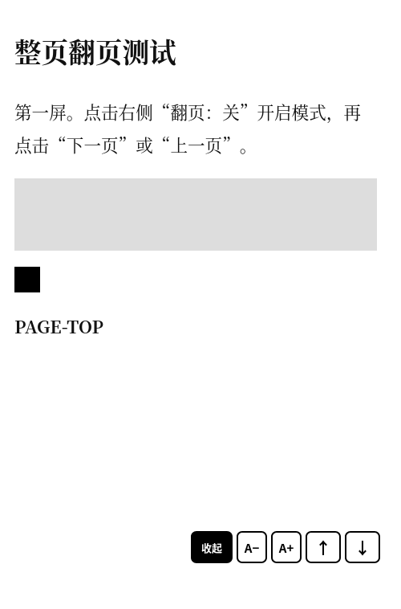

# 墨水屏翻页器（Firefox for Android）

把上下滚动的网页改成“一屏一页”的电子墨水屏阅读模式。



- 收起时只在画面右下角保留一个「展开」按钮；展开后是横排控制条：「收起 / A− / A+ / ↑ / ↓」。
- 「下一页」固定在最右侧，控制条默认放在画面底部，优先覆盖网站底部栏，减少对正文的遮挡。
- 按钮按物理尺寸固定，不会因为电脑版网页自动缩小、页面字号变化而变小；双指缩放时也会尽量反向补偿。
- 整个控制条（包括按钮之间的空白区域）都可以直接拖动，没有额外的拖动符号；松手自动保存位置，收起后也能拖。
- 新增正文字号调节：A− / A+ 每次 10%，范围 80%–180%，设置跨页面保存；收起时恢复网站原字号，展开后重新应用。
- 每次点击滚动“一屏减去重叠距离”，默认额外保留 8% 重叠区域，宁可重复一点，也不让内容卡在两页之间。
- 自动检测页面顶部/底部的固定页眉、页脚，把它们的遮挡高度计入重叠区域。
- 到达页首/页尾时给出提示。
- 展开期间把页面的 `transition` / `animation` 缩短到 1ms，并强制 `scroll-behavior: auto`，避免平滑滚动和动画残影。
- **收起会退出翻页模式**，恢复网页原本的动画和字号；「展开」按钮仍可拖动。展开/收起状态、字体大小和按钮位置都保存在 `storage.local`。
- 自动识别两类页面：普通窗口滚动，以及固定布局里的内部滚动容器。
- 使用 Shadow DOM 隔离样式；即使网站有严格 CSP，控件样式和翻页功能也能工作。

当前版本：`0.3.0`，目标 Firefox for Android 142 及以上。

> v0.3.0 改了控制条布局，按钮位置使用新的存储键，会回到“右下角”默认位置一次；之后再拖动会正常保留。

## 安装

本仓库里的 `.xpi` 是**未签名**的本地开发包。Firefox 正式版默认只能安装 Mozilla 签名的扩展，因此直接点开文件通常会失败；这属于 Firefox 的签名限制，不是扩展本身报错。

### 方案 A：adb 临时安装（本次试用推荐）

不需要签名，适合先验证功能。电脑需要 Node.js 20+、Android Platform Tools（adb）。

1. 手机打开「开发者选项」和「USB 调试」，用 USB 连接电脑，手机上允许调试。
2. 在手机 Firefox 中打开：设置 → 高级 → **通过 USB 远程调试**（不同版本可能叫“Remote debugging via USB”）。
3. 确认设备已授权：

   ```bash
   adb devices
   # 应看到形如 XXXXXXXX    device
   ```

4. 在电脑的项目目录运行：

   ```bash
   ./tools/run-in-firefox-android.sh
   ```

   脚本会检查设备，并通过 `web-ext` 把 `extension/` 作为临时扩展安装到手机 Firefox。

5. 如果电脑上装了多个 Android 设备/模拟器，把设备 ID 作为参数：

   ```bash
   ./tools/run-in-firefox-android.sh XXXXXXXX
   ```

6. 安装成功后，在手机上打开要阅读的网页，右下角应出现「展开」。调试会话用 `Ctrl+C` 结束；临时扩展会保留到 Firefox 重启。

Firefox 变体的 APK 名不同，可用环境变量指定：

```bash
# Firefox Nightly
FIREFOX_APK=org.mozilla.fenix.nightly ./tools/run-in-firefox-android.sh

# Firefox Beta
FIREFOX_APK=org.mozilla.firefox_beta ./tools/run-in-firefox-android.sh
```

### 方案 B：签名后从文件安装（可长期使用）

1. 免费注册 Mozilla Add-ons 开发者账号。
2. 在 <https://addons.mozilla.org/developers/> 选择「Submit a New Add-on」。
3. 选择 **On your own**（自行分发 / unlisted），上传 `dist/eink-page-turner-0.3.0.zip`。
4. 等待自动签名完成，下载签名后的 `.xpi`。
5. 把签名后的 `.xpi` 传到手机。
6. 手机 Firefox 中打开：设置 → 关于 Firefox → 连续点 5 次 Firefox 图标，解锁隐藏菜单。
7. 返回设置 → **Install Extension from File**（从文件安装扩展）→ 选择 `.xpi` → 添加。

> 这是 Android 版 Firefox 官方提供的从文件安装路径，但只接受已签名扩展。

### 方案 C：直接尝试本地包

如果手机上是 Firefox Nightly，并且已关闭扩展签名校验，可以直接把 `dist/eink-page-turner-0.3.0.xpi` 传到手机，按方案 B 第 6–7 步操作。正式版、Beta 版通常不接受未签名包。

## 使用

1. 打开任意 `http://` 或 `https://` 网页。
2. 点右下角「展开」→ 显示「收起 / A− / A+ / ↑ / ↓」横排控制条，并开启翻页模式。
3. 点最右侧「↓」向前翻一屏，点「↑」回退一屏；翻页步长会自动减去重叠区域。
4. 按住控制条任意位置拖动（按钮上或按钮之间的空白都可以），可把它放到屏幕任意位置。
5. 点「A+」增大正文字号，点「A−」减小；每次 10%，达到上限/下限会有提示。
6. 到边界时会出现「已到页首 / 已到页尾」提示。
7. 点「收起」隐藏控制条并恢复网页原动画、原字号；右下角仍保留可拖动的「展开」。

翻页模式展开时，用手指滑动仍然可用。按钮是主操作方式；目前不会强制锁死触摸滚动，以免网页内的菜单、弹窗无法滚动。

### 按钮大小与页面缩放

电脑版网页在手机上常会以 980px 等宽布局整体缩小显示。扩展会读取屏幕宽度与可视视口比例，对按钮做反向缩放，所以按钮的物理高度保持约 40px，而不是跟着网页一起变成很小。双指缩放时也会尝试按 `visualViewport` 重新计算；但不同 Firefox 版本处理固定定位和缩放的方式可能略有差别，这一点属于尽力适配。

### 字号调节说明

字号调节只处理网页中的文字元素，会跳过固定页眉/页脚、导航、按钮、输入框以及 `pre/code` 等区域，避免把网站控件撑坏。它使用内联字号和行高覆盖，因此对常见正文页面有效；如果网站使用 Canvas 自绘文字、图片文字或非常特殊的布局，则可能不生效或产生排版偏移。新加载的章节内容如果没有被缩放，再点一次 A+/A− 或收起后重新展开即可重新应用。

## 已知限制

- 只注入顶层页面，不处理 iframe 内部的滚动区域。
- **不支持 Firefox 自带的阅读模式（`about:reader`）和 PDF 阅读器**：Firefox 不允许扩展向这类内部页面注入脚本。请直接在原网页上开启本扩展。
- 不匹配本地 `file://` 页面，只处理 `http://` 和 `https://` 网页。
- 不适用于 Canvas 自绘阅读器、使用 `transform` 模拟滚动的站点。
- 页面在 Shadow DOM 里创建的内部滚动容器可能无法自动识别；大多数普通电子书站点不受影响。
- 翻页按“当前可视高度减去重叠距离”计算，不按网站的分页/章节边界计算。
- 页眉/页脚检测基于屏幕上下边缘的命中测试；宽度不足半屏的浮动按钮或特殊布局的页眉可能不会被识别。
- 双指缩放下的按钮尺寸/位置补偿是尽力适配，极端缩放或浏览器特殊模式下仍可能有偏差。
- 字号调节依赖对页面文字元素写入内联样式，复杂网页可能出现局部排版变化；收起后会恢复原状。动态新增的内容可能需要再操作一次字号按钮才会应用。
- 控件会遮住所在位置的一小块内容，默认放在底部右侧以覆盖网站底栏，可随时拖走。

## 目录

```text
extension/                 扩展源码
  manifest.json
  content.js
  content.css
  icons/
dist/                      构建产物
  eink-page-turner-0.3.0.xpi
  eink-page-turner-0.3.0.zip
  SHA256SUMS.txt
tools/
  run-in-firefox-android.sh
tests/                     桌面 Firefox 自动化测试与测试页
build.sh                   重新打包
```

## 开发与验证

```bash
./build.sh
npx --yes web-ext@10.8.0 lint --source-dir extension --output text
```

桌面 Firefox 自动化测试（需要本机 Firefox、Python 3、Selenium 和 geckodriver）：

```bash
python3 -m http.server 8765 --bind 127.0.0.1
python3 -m venv .venv
.venv/bin/pip install selenium
.venv/bin/python tests/test_extension.py
```

测试覆盖：展开/收起状态、横排与最右下一页、默认右下角、整条拖动、正文字号增减与行高变化、字号收起/展开恢复、位置/字号/状态持久化、重叠步长、固定页眉页脚检测、页尾提示、内部滚动容器、CSP 页面样式隔离。截图位于 `tests/artifacts/`。

## 隐私

扩展不收集、不发送任何数据，只使用 `storage` 保存展开状态、按钮坐标和字号比例。清单中已声明 `data_collection_permissions.required = ["none"]`。
